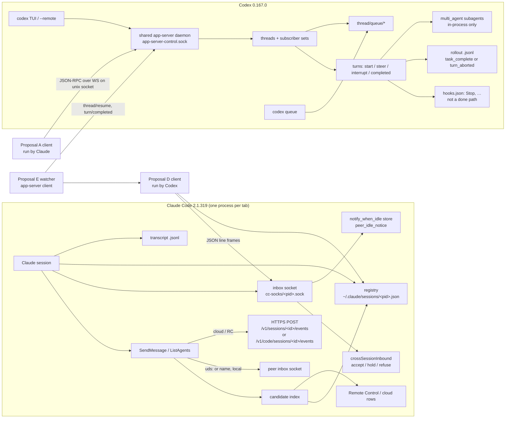
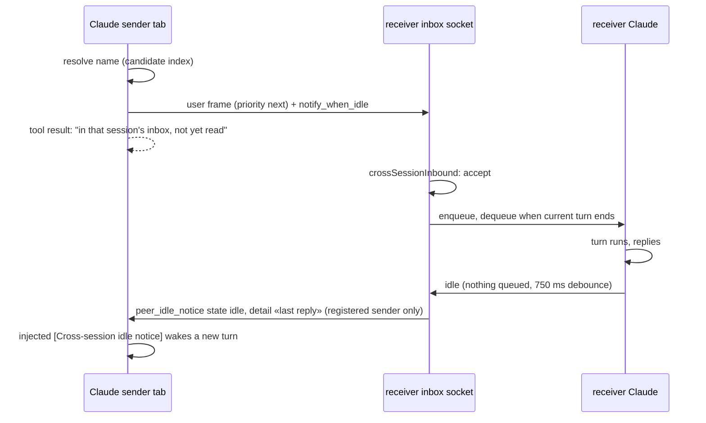
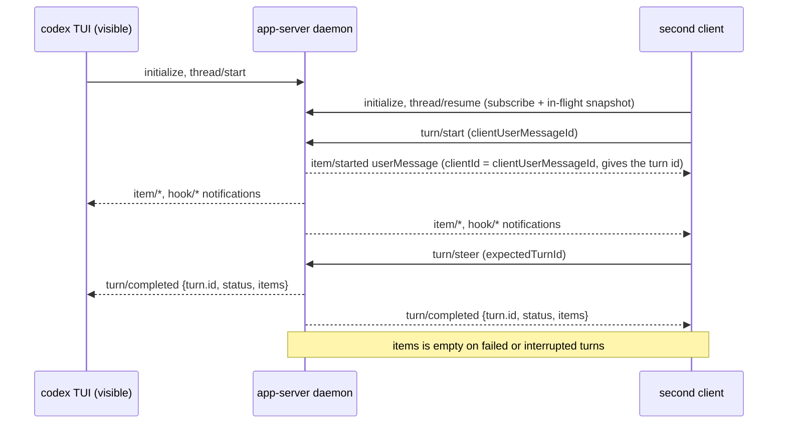
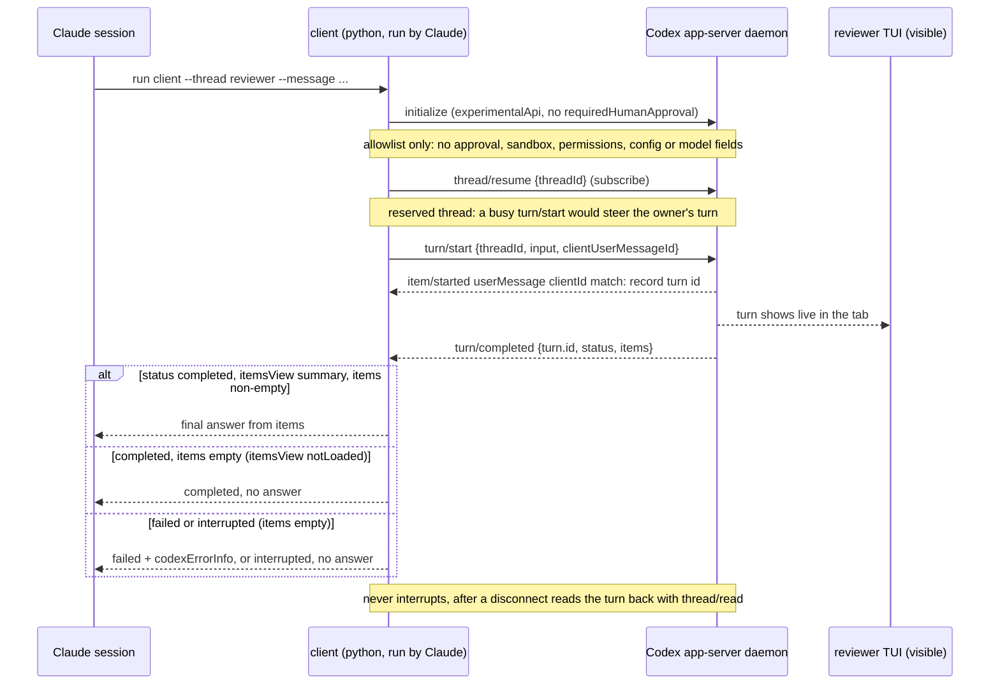
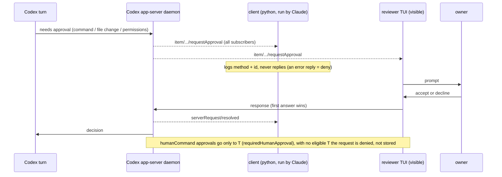
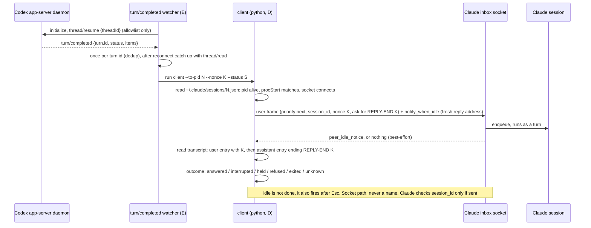
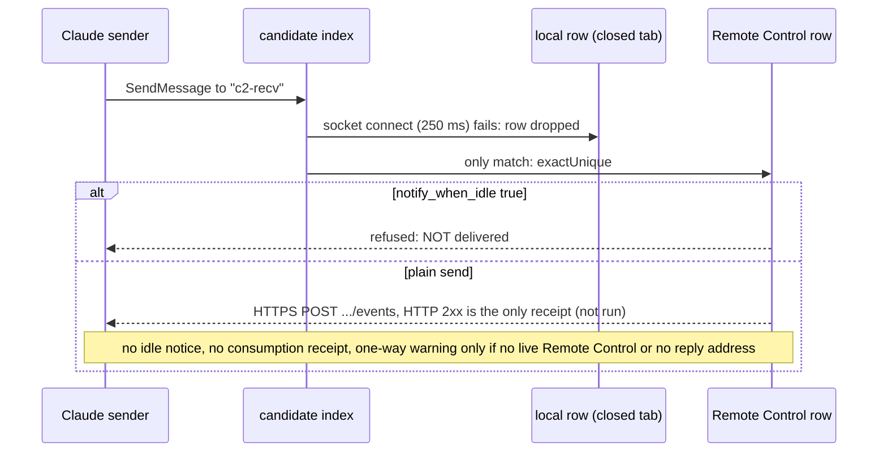

# Diagrams

## Components and dependencies

## Claude -> Claude: SendMessage with notify_when_idle (C2)

## Codex <-> Codex: two clients on one thread (P1)

## Proposal A: Claude asks a visible Codex reviewer

## Approval fan-out on a joined thread

## Proposals D + E: Codex reports to Claude (gated by the delivery contract)

## Dead-tab fallthrough

